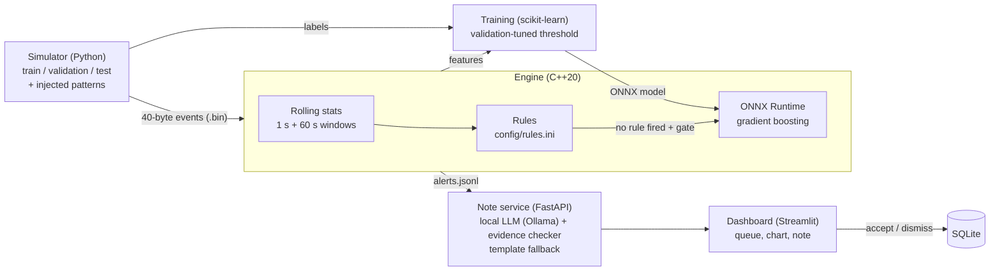

# Trade Surveillance Agent

Watches simulated trading events, flags spoofing, wash trading and pump-and-dump with a C++
rules + ML engine, and writes evidence-checked case notes for a human reviewer.

> **Simulated data only.** This is a learning project, not a real compliance tool. No real
> market or customer data is used, and nothing here should be relied on to detect misconduct.

**Demo video:** _to be recorded_ (script: [docs/demo.md](docs/demo.md)).

## Run the demo (one command)

Needs [Docker Desktop](https://www.docker.com/products/docker-desktop/) (on Windows, with WSL 2).

```powershell
git clone https://github.com/Bplhansi/trade-surveillance-agent.git
cd trade-surveillance-agent
docker compose up --build
```

The first run takes several minutes: it simulates the market, trains and exports the model,
runs the engine, writes case notes and starts the dashboard. Then open
**http://localhost:8501**. The note service is at http://localhost:8000/docs.

Optional, for notes written by a local LLM instead of templates: install
[Ollama](https://ollama.com) (free, runs on your PC), run `ollama pull qwen2.5:3b`, and copy
`.env.example` to `.env`. Without it, every alert still gets a template note.

## Architecture



| Part | Folder | What it does |
| --- | --- | --- |
| Simulator | `sim/` | Normal market + injected spoofing, wash trades, pump-and-dump, with labels ([data contract](docs/data.md)) |
| Engine | `engine/` | Reads events, keeps per-trader rolling statistics, runs rules, then the model ([C++ tests](engine/tests)) |
| ML | `ml/` | Feature export, Isolation Forest + gradient boosting, threshold choice, ONNX export, per-case grading |
| Note service | `service/` | Alert → case → LLM note (Ollama) → evidence check → template fallback ([API](docs/api.md)) |
| Dashboard | `dashboard/` | Review queue, price chart, note, accept/dismiss log ([plan](docs/dashboard-plan.md)) |

## Results

Test set scored **once**, with settings frozen on the validation set. Grading is per
injected case (34 test cases). Full details and every tuning step: [docs/results.md](docs/results.md).

| Method | Precision | Recall | False alarms per 10k events | Median latency | p99 latency |
| --- | --- | --- | --- | --- | --- |
| Rules only | 0.971 | 0.853 | 0.04 | 300 ns | 1,600 ns |
| Isolation Forest | 0.706 | 0.353 | 0.20 | not deployed | not deployed |
| Gradient boosting (Python, every event) | 1.000 | 0.588 | 0.00 | not deployed | not deployed |
| **Rules + model in C++** | **0.984** | **0.882** | 0.04 | 1,000 ns | 71,600 ns |

Engine with rules + model: **101,918 events/s**, p50 1.0 µs, p99 71.6 µs (training set, 5 runs).
Case notes: 85 / 85 validation alerts got a note that passed the evidence check (template
notes). Notes from the local LLM (Ollama, qwen2.5:3b) are being measured; see docs/results.md.

**Test machine:** Intel Core i5-1135G7 (4 cores / 8 threads, 2.4 GHz), 7.8 GB RAM,
Windows 11 Home, MSVC Release /O2, single thread.

## Design decisions and trade-offs

- **Rules first, model second.** Rules are explainable and generalise to smaller patterns;
  the model only scores events that pass a cheap gate. Together they beat either alone.
- **Honest evaluation.** Separate train / validation / test sets with different traders and a
  deliberately shifted test set. Tuning on validation only; test scored once and the result
  kept even when it was disappointing (the model alone does *not* beat the rules).
- **The LLM explains, never decides.** It sees only the alert's numbers, must reply in a fixed
  JSON shape, and every number in its note must appear in the alert, with no links or HTML;
  otherwise a template note is used. It has no tools and cannot change any alert.
- **ONNX Runtime in C++** rather than calling Python, so the engine stays one process.
  C++ and Python scores match to 3.9e-6.
- **Reviewer decisions are append-only** in SQLite with UTC timestamps (an audit trail).
- **Tests first.** 113 C++ tests (also run under AddressSanitizer + UBSan in CI) and 135 Python
  tests (98% line coverage); CI also runs the Docker demo from a clean machine.

## Known limits and next steps

- **Model cost:** each model call takes about 45 µs (800 trees); session tuning didn't help.
  Next: a smaller model, a stricter gate, or scoring several events per call.
- **Distribution shift:** the model learned training-sized patterns and misses smaller ones;
  the gate costs it further on test (0.588 → 0.441 recall). Next: size-relative features and
  a shifted validation set.
- **Local LLM notes are slow on a laptop CPU** (tens of seconds each) and small models make
  up numbers more often; the evidence checker then falls back to a template note.
- **Evidence checker** checks numbers, links and HTML, not meaning: a note could still
  describe the numbers misleadingly. Spelled-out numbers ("three") are not checked.
- **Local only:** the note service and dashboard have no login; ports bind to 127.0.0.1.
- Simulated market only; no order book depth, no real venues, PyTorch model skipped.

## Develop locally (Windows, PowerShell)

Requires Python 3.11+, a C++20 compiler (Visual Studio 2022) and CMake 3.20+.

```powershell
python -m venv .venv
.\.venv\Scripts\python.exe -m pip install -r requirements-dev.txt
.\.venv\Scripts\python.exe -m pytest

cmake -S engine -B engine/build -DCMAKE_BUILD_TYPE=Release -DPython3_EXECUTABLE="$PWD\.venv\Scripts\python.exe"
cmake --build engine/build --config Release
ctest --test-dir engine/build -C Release --output-on-failure
```

More commands: [docs/commands.md](docs/commands.md).
