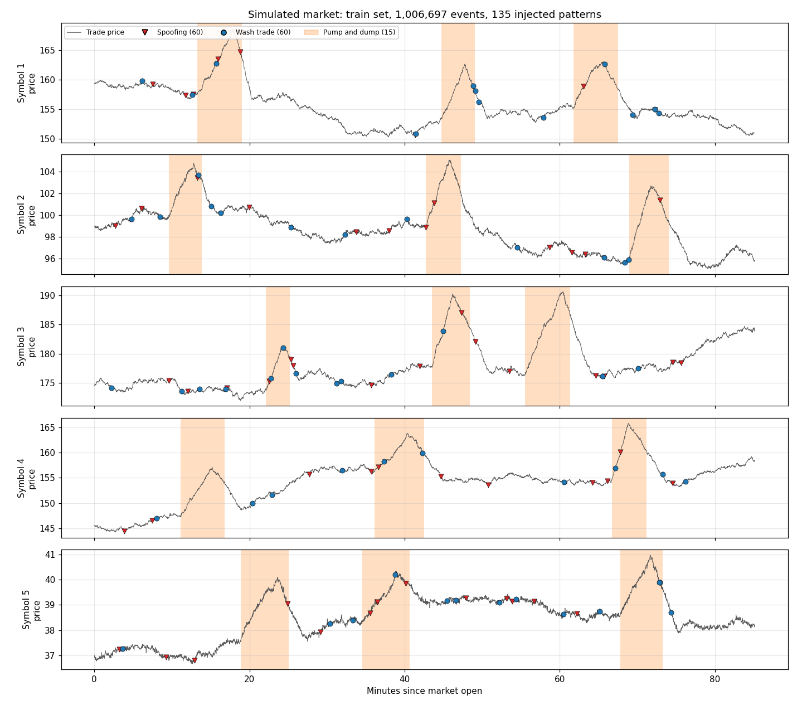

# Simulated data: contract

Generated by `python -m sim.generate --out data`. Files live in `data/`, which is
not committed; anyone can recreate them byte-for-byte from the seed.

## Datasets

| Dataset | Normal events | Seed | Bad-actor trader IDs | Pattern sizes |
| --- | --- | --- | --- | --- |
| train | 1,000,000 | 42 | 1–250 | `TRAIN_SIZES` |
| validation | 250,000 | 43 | 1–250 | `TRAIN_SIZES` |
| test | 250,000 | 44 | 251–500 (never bad actors in train/validation) | `TEST_SIZES` (different) |

Injected per million normal events: 60 spoofing, 60 wash trade, 15 pump and dump.
About 0.5–1% of events are suspicious. Each dataset is generated separately (not split from
one stream), so no events are shared between them.

## Files (per dataset, e.g. `train`)

| File | Contents |
| --- | --- |
| `train.events.bin` | Events in the shared 40-byte format (`engine/include/tsa/event.hpp`), sorted by time |
| `train.labels.csv` | One row per suspicious event: `event_index, order_id, trader_id, pattern, pattern_id`. `event_index` is the row number in `events.bin`. Events not listed are normal. |
| `train.patterns.csv` | One row per injected instance: `pattern_id, pattern, trader_id, symbol_id, start_ns, end_ns` |
| `train.manifest.json` | Seed, full config, event and instance counts, suspicious fraction, SHA-256 of each file |

`pattern` is one of `spoofing`, `wash_trade`, `pump_and_dump`.

## Rules that later steps can rely on

- **Grain:** one row = one event. Order IDs are renumbered 1, 2, 3… in order of first
  appearance, so an ID never reveals whether an order was injected.
- **Bad actors are ordinary traders too:** their IDs come from the normal population and they
  also trade innocently; only their pattern events are labelled.
- **Innocent counterparties are not labelled:** the trader on the other side of a bad actor's
  fill did nothing wrong.
- **Decoys:** innocent traders sometimes place and cancel very large orders, so "large cancel"
  alone is not spoofing.
- **Leakage guard:** labels and pattern files are for evaluation only. Features must be built
  from `events.bin` using only events at or before the time being scored.
- **Thresholds** are chosen on validation; the test set is used once at the end.

## What the patterns look like

| Pattern | Injected behaviour |
| --- | --- |
| Spoofing | Bursts of large orders stacked 1–N ticks from the mid on one side, a small real order on the other side that fills, then every large order cancelled within 50–400 ms |
| Wash trade | Same trader places a buy and a sell at the same price and size; both fill against each other; repeated every 0.5–3 s |
| Pump and dump | Price of one symbol is pushed up by a few % over minutes while one account buys repeatedly, then the account sells its whole position as the price falls |

## Alerts file (written by the engine)

`tsa_replay <events.bin> --rules config/rules.ini --alerts <name>.alerts.jsonl` writes one
JSON object per line (JSON Lines), in event order:

| Field | Meaning |
| --- | --- |
| `alert_id` | 1, 2, 3 … within the file |
| `rule` | `spoofing`, `wash_trade` or `pump_and_dump` (same names as `pattern` above) |
| `timestamp_ns`, `trader_id`, `symbol_id` | from the event that triggered the alert |
| `event_index` | row of that event in the events file (0-based, same as `labels.csv`) |
| `window` | `1s` or `60s`: which rolling window the evidence comes from |
| `evidence` | the rolling statistics the rule looked at for this trader + symbol (orders, cancels, large orders/cancels, buy/sell/net volume, trades, first trade price, price change, self-trades) |

Thresholds live in `config/rules.ini`. At most one alert per rule + trader + symbol is
raised per cooldown (60 s by default). Alerts files go in `data/` and are not committed.

## Limits

This is a simple statistical market, not a real exchange: there is no full order book or
matching engine, and prices follow a random walk. It is good enough to build and compare
detectors, not to draw conclusions about real markets.
